<p align="center">
  
</p>

<h1 align="center">Wakaranai</h1>

<p align="center">
  Manga, anime, novels and audiobooks in one Android app, from sources you choose.
</p>

<p align="center">
  <a href="https://github.com/Sayuri128/wakaranai/releases/latest"><b>Download the latest APK</b></a>
</p>

Wakaranai doesn't ship with any site built in. Every source is an **extension**: a JSON config
and a script in [Capyscript](https://github.com/Sayuri128/capyscript), loaded from a GitHub
repository and run on the device. When a site changes, its extension gets updated and the app
picks up the new version on its own, without a new app release.

## Screenshots

<table>
  <tr>
    <td align="center"><br/><sub>Library</sub></td>
    <td align="center">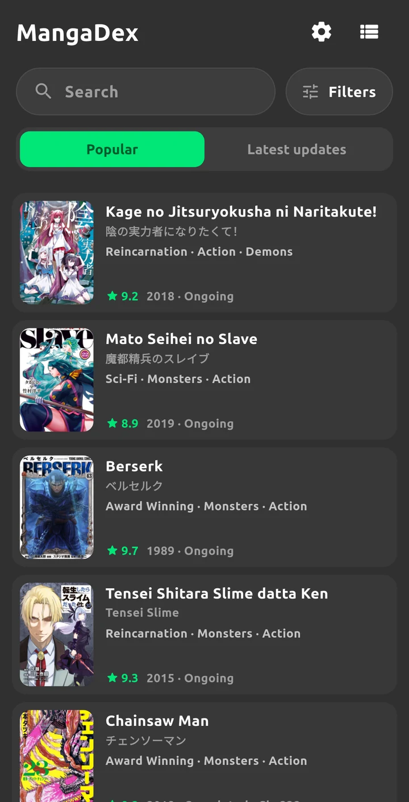<br/><sub>Source with feeds</sub></td>
    <td align="center"><br/><sub>Title page</sub></td>
  </tr>
  <tr>
    <td align="center">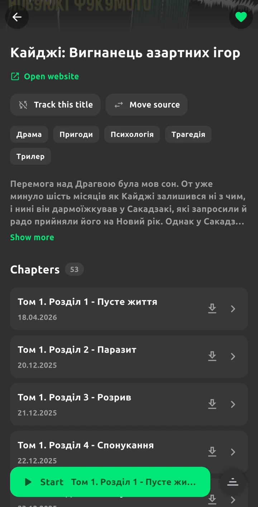<br/><sub>Chapters</sub></td>
    <td align="center"><br/><sub>Reader</sub></td>
    <td align="center">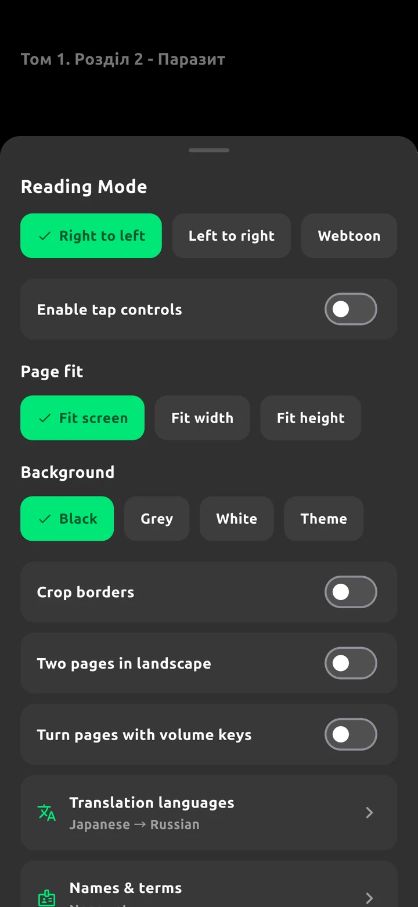<br/><sub>Reading modes</sub></td>
  </tr>
  <tr>
    <td align="center">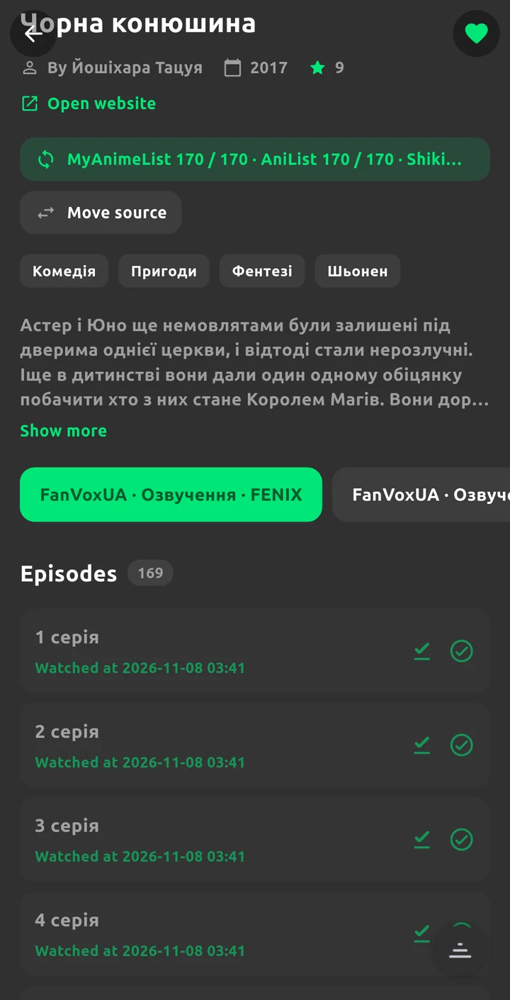<br/><sub>Episodes, dubs and tracker sync</sub></td>
    <td align="center">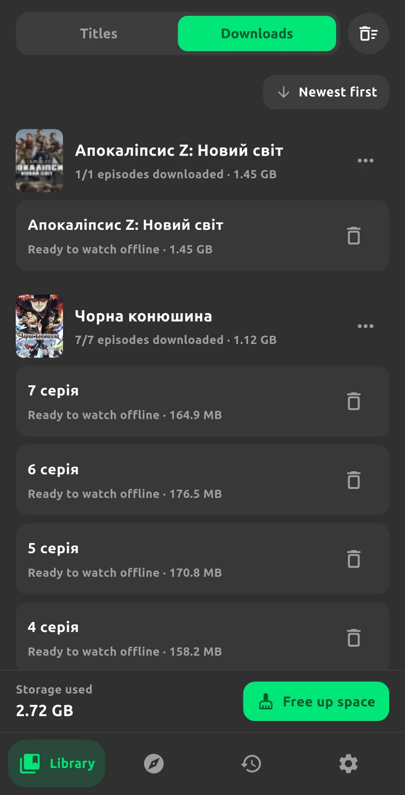<br/><sub>Downloads</sub></td>
    <td align="center">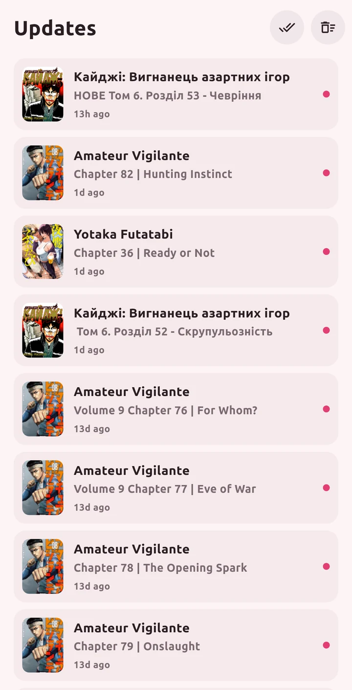<br/><sub>New chapters</sub></td>
  </tr>
  <tr>
    <td align="center" colspan="3"><br/><sub>Video player</sub></td>
  </tr>
  <tr>
    <td align="center"><br/><sub>Novels</sub></td>
    <td align="center"><br/><sub>Audiobooks</sub></td>
    <td align="center">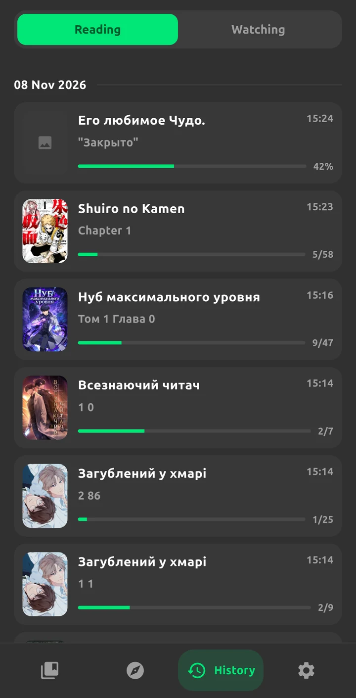<br/><sub>History</sub></td>
  </tr>
  <tr>
    <td align="center">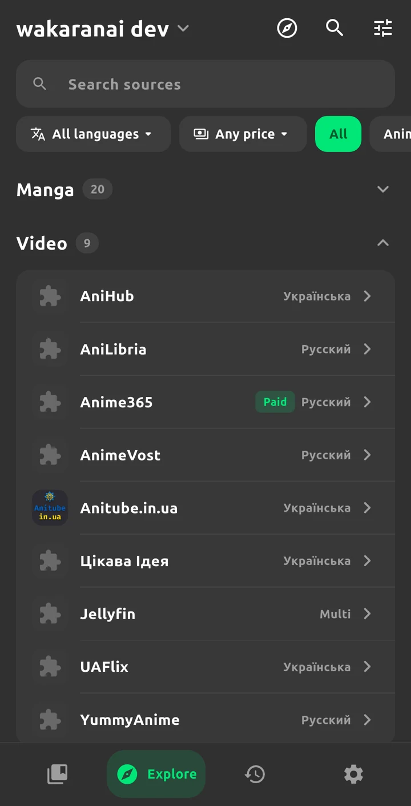<br/><sub>Extensions</sub></td>
    <td align="center">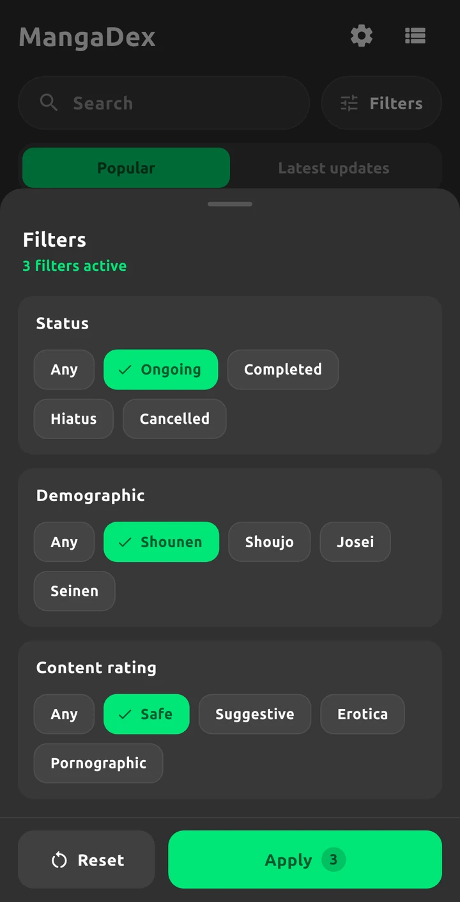<br/><sub>Source filters</sub></td>
    <td align="center">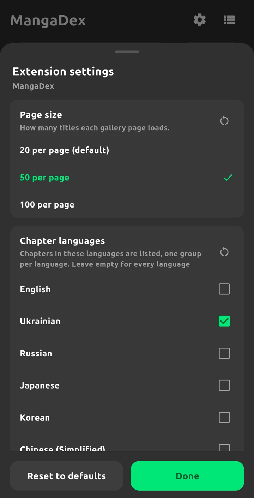<br/><sub>Extension settings</sub></td>
  </tr>
  <tr>
    <td align="center">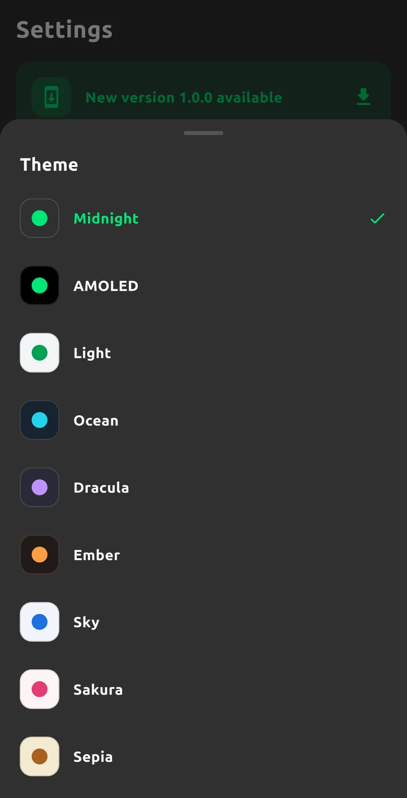<br/><sub>Nine themes</sub></td>
    <td align="center"><br/><sub>Sakura theme</sub></td>
    <td></td>
  </tr>
</table>

## Features

**Reading and watching**
- Manga reader with right-to-left, left-to-right and webtoon modes, page fit, border cropping,
  two-page spreads in landscape, tap zones and page turning with the volume keys.
- On-device page translation: text recognition, translation and typesetting over the page, with
  per-title languages and a glossary for names.
- Novel reader with adjustable text size, spacing, margins, font and background.
- Video player with quality, source and audio track selection, skip intro and outro buttons
  (or automatic skipping), playback speed and picture-in-picture. External players such as MX
  Player and VLC work too.
- Audiobook player that keeps going in the background, with lock-screen controls, a sleep timer
  and per-track progress.

**Library**
- Categories, search and sorting, plus a Continue button that opens the next unread chapter or
  unwatched episode.
- Background checks for new chapters and episodes, with notifications, an updates feed and
  optional auto-download.
- Moving a title to another source keeps its progress.
- Progress sync with AniList, MyAnimeList and Shikimori.
- History, reading statistics and an incognito mode.

**Downloads**
- Chapters and episodes (HLS and MP4) for offline use, with a reorderable queue, pause and resume,
  a Wi-Fi only option and a download quality setting.
- Storage overview, free-up-space tools and automatic deletion of watched episodes.

**Sources**
- Browse, search and filter each source; sources can offer several feeds (Popular, Latest, …) as
  tabs.
- Search across every installed source at once, or start from AniList's Discover.
- Per-extension settings: mirrors, page size and options the extension declares.
- Filter the source list by language, price and type (website, self-hosted, official).
- Sources behind Cloudflare-style checks or logins open in an in-app browser and reuse its
  session.
- Local files: CBZ/ZIP archives, image folders and EPUB books from the device.

**Everything else**
- Nine themes: Midnight, AMOLED, Ocean, Dracula and Ember (dark), Light, Sky, Sakura and Sepia
  (light).
- English and Ukrainian interface.
- Backup and restore of the library, history, categories, sources and settings, with optional
  automatic backups.

## Extensions

The official extensions live in
[wakaranai_configs](https://github.com/Sayuri128/wakaranai_configs). There are about 30 of them:
manga sites (MangaDex, MangaLib, ReManga, Zenko, Honey Manga and more), video (AniLibria,
Anitube, UAFlix, YummyAnime and more), novels (RanobeLib, Ficbook), audiobooks (LibriVox), and
self-hosted servers (Komga, Kavita, Suwayomi, OPDS catalogs, Jellyfin). The full list is in that
repository's README.

You can add any GitHub repository with the same layout as a source in the Explore tab, and pick
the branch to read from. To write your own extension, start with the guides:

- [Extensions](docs/guides/extensions.md): config fields, script functions, preferences, feeds,
  pagination and filters
- [Capyscript syntax](docs/guides/capyscript_syntax.md)
- [Capyscript modules](docs/guides/caypscript_modules.md)

## Building

Wakaranai is a Flutter app. Only Android is maintained; the other platform folders exist but are
untested.

```bash
cp example.env .env      # required; tracker client ids are optional
flutter pub get
flutter run
flutter test
```

Debug builds install next to the release build as "Wakaranai Debug", so they never touch your
real library.

## Disclaimer

Wakaranai doesn't host or distribute any content. Extensions load pages from third-party websites
that are not affiliated with this project. Whether you may access a given site depends on the site
and on where you live.

## License

[Apache License 2.0](LICENSE)
