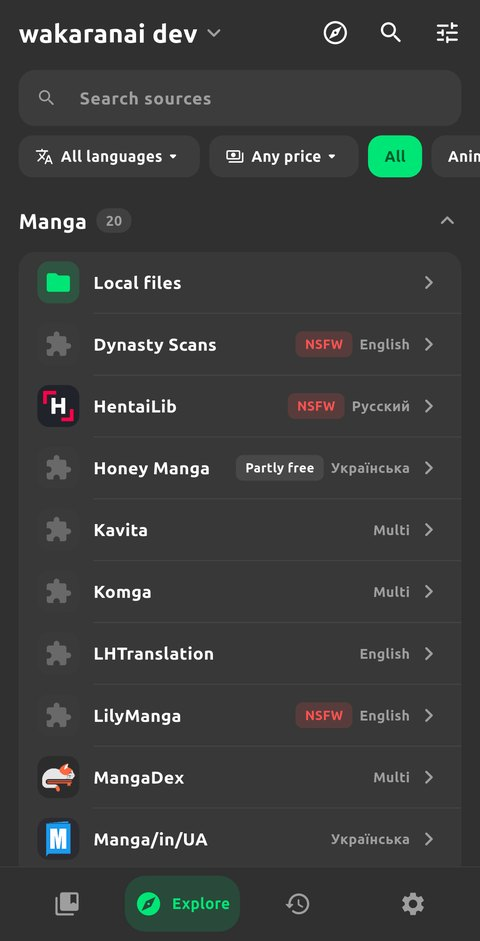
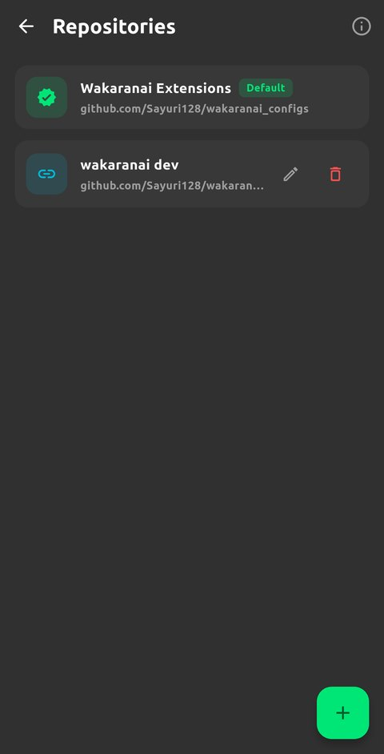
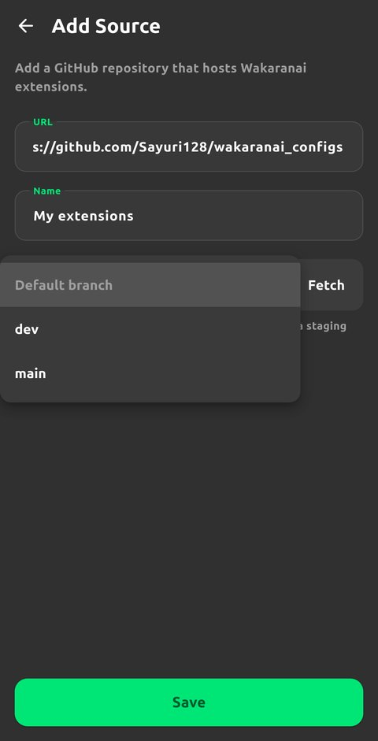

# External Extension Sources

Wakaranai loads every source from a GitHub repository at runtime, so you can point the app at your
own repository instead of (or alongside) the official one.

## Adding a repository

On the **Explore** tab, tap the repository name at the top of the screen to open **Repositories**,
then tap the **+** button and fill in:

* **URL** — the GitHub repository, e.g. `https://github.com/Sayuri128/wakaranai_configs`
* **Name** — how the repository is labelled in the app
* **Branch** *(optional)* — tap **Fetch** to load the repository's branches and pick one. Leave it on
  *Default branch* for normal use; select a branch when you want to test extensions on a staging ref
  before merging them.

Saved repositories appear in the same list. Tap one to switch the Explore page to it, or use the
pencil and trash icons to edit or remove it. The official **Wakaranai Extensions** repository is
always listed first and cannot be removed.

<table>
  <tr>
      <td>
        
      </td>
      <td>
         
      </td>
      <td>
         
      </td>
  </tr>
</table>

## Repository structure

The repository needs at least one of the `manga`, `anime`, `novel` and `audio` directories, with one
directory per extension containing a `config.json` and a `main.capyscript`:

```
├── manga
│   ├── extension1
│   │   ├── config.json
│   │   └── main.capyscript
│   ├── extension2
│   │   ├── config.json
│   │   └── main.capyscript
├── anime
│   ├── extension1
│   │   ├── config.json
│   │   └── main.capyscript
├── novel
│   ├── extension1
│   │   ├── config.json
│   │   └── main.capyscript
├── audio
│   ├── extension1
│   │   ├── config.json
│   │   └── main.capyscript
```

Ready-made starting points for each type are in the
[extension templates](../guides/extension_templates).

## Optional: index.json

If a file named `index.json` exists at the root of the repository, the app reads it instead of
listing directories through the GitHub API. This is a single request rather than one per extension,
so it loads faster and is much less likely to hit GitHub's rate limit for unauthenticated requests.

```json
{
  "schemaVersion": 1,
  "configs": [
    {
      "category": "manga",
      "path": "manga/extension1",
      "revision": "7cd0cbcd61367c08",
      "apiVersion": 2,
      "minAppVersion": "1.0.0",
      "config": { "...contents of config.json..." }
    }
  ]
}
```

* `revision` is any string that changes whenever the extension changes. Installed extensions update
  when it differs. Without it, the app compares `version` from `config.json` instead.
* `apiVersion` and `minAppVersion` are copied from `config.json`, so the app can mark an extension
  that needs a newer app without downloading its script.

The easiest way to produce this file is
[`tool/build_index.dart`](https://github.com/Sayuri128/wakaranai_configs/blob/main/tool/build_index.dart)
from the official repository; run it again whenever you add or update an extension.

If `index.json` is missing, the app falls back to scanning the `manga`, `anime`, `novel` and `audio`
directories, so it is entirely optional.

See the guide for creating extensions [here](../guides/extensions.md).
